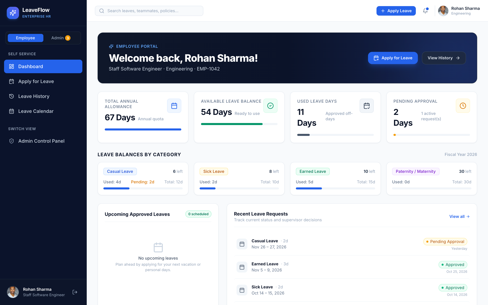
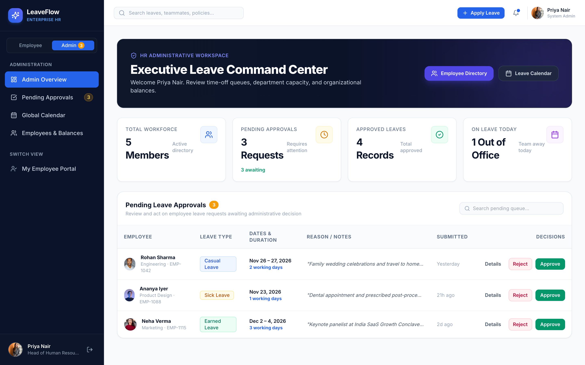
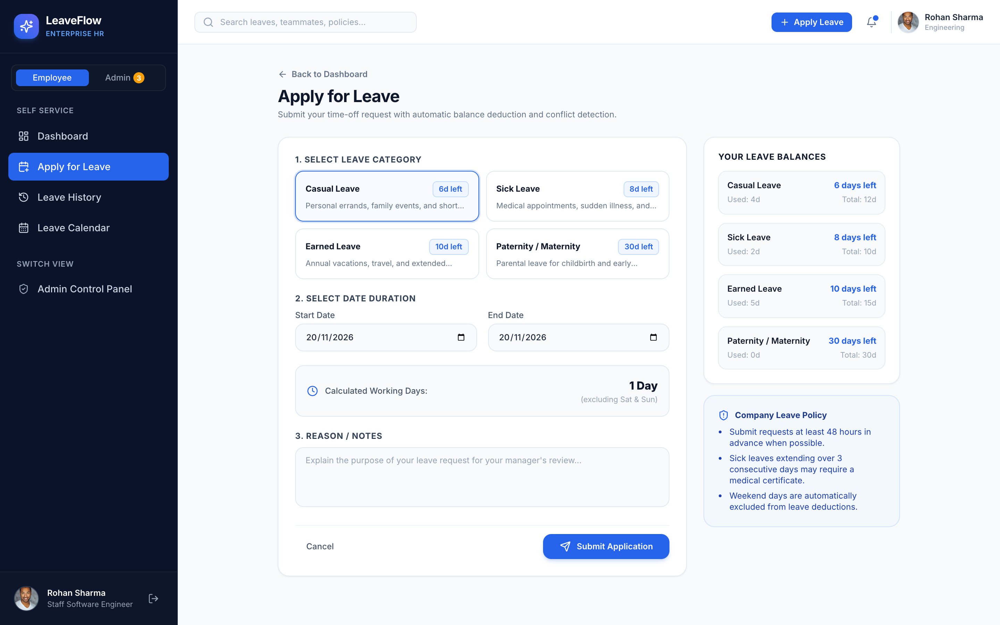
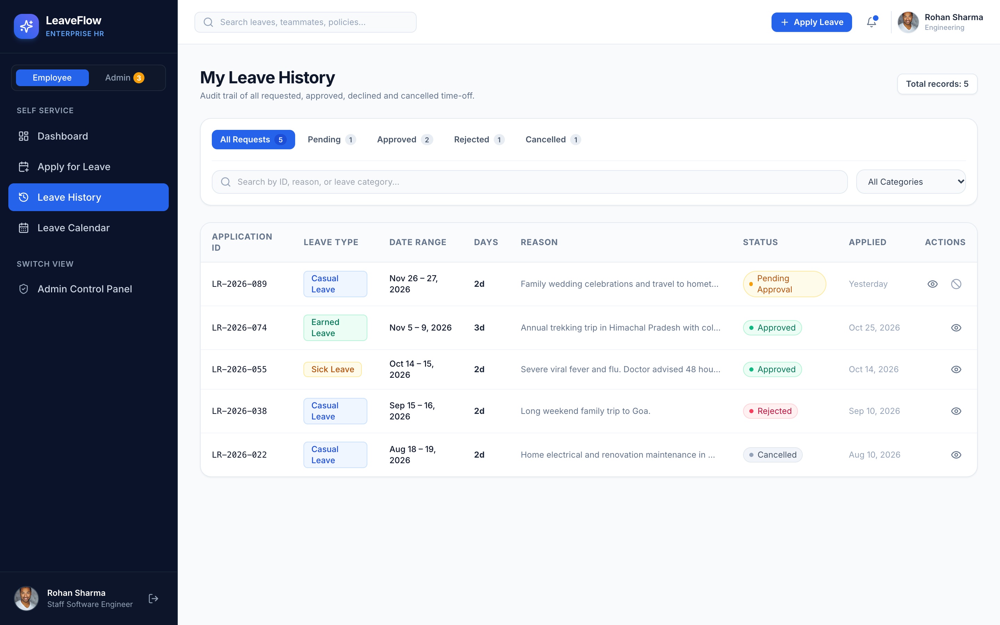
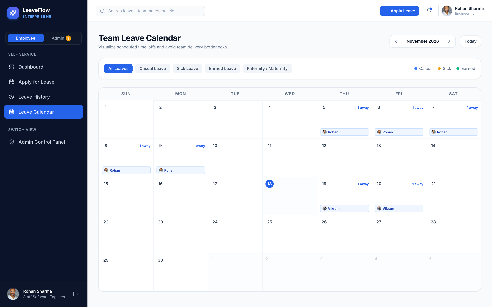
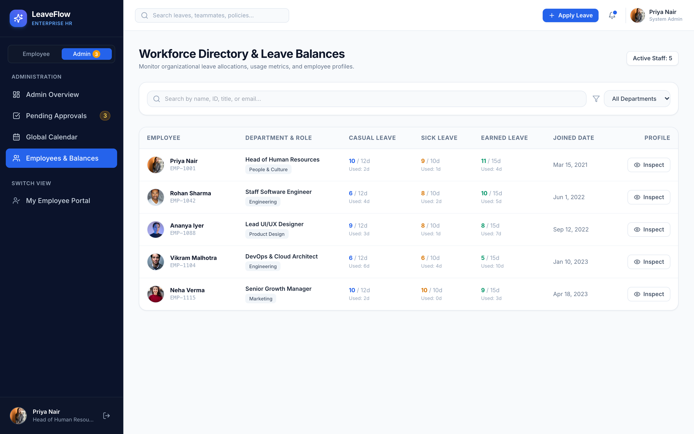
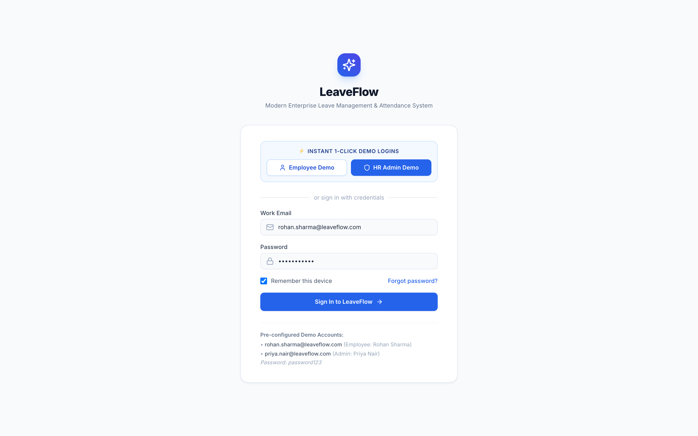
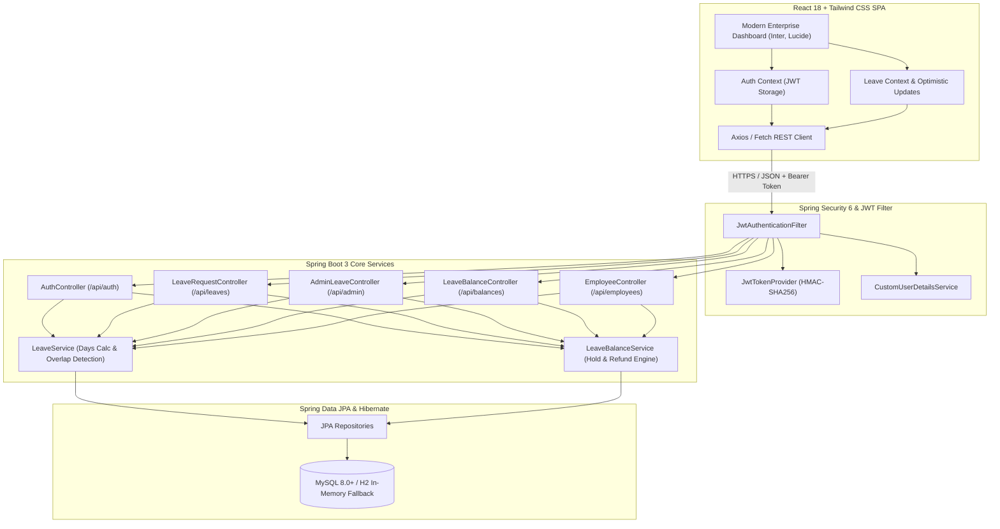
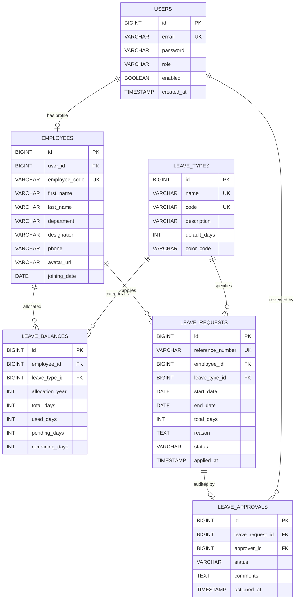

# LeaveFlow – Enterprise Employee Leave Management System

[](https://spring.io/projects/spring-boot)
[](https://openjdk.org/)
[](https://react.dev/)
[](https://tailwindcss.com/)
[](https://www.mysql.com/)
[](https://spring.io/projects/spring-security)
[](https://jwt.io/)
[](LICENSE)

**LeaveFlow** is an enterprise-grade Human Resources Leave Management and Attendance tracking SaaS platform. Engineered with a **Java 21 & Spring Boot 3** REST backend and a **React + Tailwind CSS** frontend, it delivers an intuitive user experience inspired by modern enterprise products like **Linear**, **Stripe**, and **ZenHR**.

---

## 📸 Application Screenshots & UI Tour

### 1. Employee Self-Service Dashboard
The central hub for staff members, presenting leave allowance counters, active balances, upcoming planned absences, and real-time request timeline.


---

### 2. HR Administrator Command Center
Executive oversight displaying workforce KPIs, a pending approvals decision queue, quick approval/rejection actions with mandatory feedback, and recent approvals.


---

### 3. Application Form & Smart Validator
Leave submission modal featuring automated working-day calculation (excluding weekends), dynamic balance checks, and concurrency conflict prevention.


---

### 4. Leave History & Request Audit Trail
Searchable, filterable audit table with status indicators (`APPROVED`, `PENDING`, `REJECTED`, `CANCELLED`), detailed request modals, and self-service cancellation.


---

### 5. Interactive Team Absence Calendar
Cross-departmental schedule calendar highlighting approved colleague absences with color-coded categories and day-by-day attendee details.


---

### 6. Workforce Directory & Quota Overview
Full employee roster with department filters, keyword search, and detailed breakdowns of Annual Paid Leave, Sick Leave, and Casual Leave balances.


---

### 7. Secure Authentication Portal
Clean enterprise authentication supporting JWT security, BCrypt credentials, and instant 1-click role demo logins for Employee (**Rohan Sharma**) and Admin (**Priya Nair**).


---

## 🌟 Key Features

### 👤 Employee Self-Service Portal
- **Annual Allowance & Balance Cards:** Real-time visibility into annual quota, used days, active pending requests, and available balance.
- **Leave Application with Smart Checks:**
  - Automated working days calculator (automatically excludes Saturdays and Sundays).
  - Overlap prevention algorithm prohibiting conflicting or concurrent time-off requests.
  - Real-time balance threshold checking preventing over-limit submissions.
- **My Leave History & Audit Trail:** Interactive data table with status filtering (Pending, Approved, Rejected, Cancelled), search, details inspector, and applicant cancellation.
- **Interactive Team Leave Calendar:** Monthly grid view showcasing approved colleague absences, color-coded categories, and daily inspector drawer.

### 🛡️ HR Administrator Command Center
- **Executive KPI Dashboard:** Real-time workforce metrics: Total Employees, Pending Approvals Queue, Approved This Month, and Employees On Leave Today.
- **Direct Approval Workflow:** 1-click Approval and 1-click Rejection with required administrative feedback comments.
- **Workforce Directory & Leave Balances:** Department-level filtering, search by name/employee ID/designation, and full leave balance breakdown for all staff.
- **Audit Decision Logs:** Complete decision history recording approver identity, timestamps, and feedback notes.

---

## 🏗️ Architecture & Flow



---

## 🛠️ Technology Stack

| Component | Technology | Description |
| :--- | :--- | :--- |
| **Frontend Framework** | React.js 18 + Vite | Modern single-page application with lightning-fast HMR |
| **Styling & UI** | Tailwind CSS + Lucide Icons | Deep navy enterprise palette (`#0B132B`), Inter typography |
| **Routing & State** | React Router v6 + Context API | Protected route guards, role-based views, state synchronization |
| **Backend Framework** | Java 21 / 24 + Spring Boot 3.3.4 | Robust, type-safe RESTful web services |
| **Security & Auth** | Spring Security 6 + JJWT 0.12.6 | Stateless JWT authentication, BCrypt hashing, `@PreAuthorize` |
| **ORM & Data Layer** | Spring Data JPA / Hibernate 6 | Automated schema migrations, parameterized repository queries |
| **Database** | MySQL 8.0+ (Production) / H2 (Dev) | Relational database with foreign key constraints & unique indexes |
| **Testing & Tools** | JUnit 5, MockMvc, Postman, Maven | Integration test suite and Postman API collection |

---

## 🗄️ Database Schema Design

The relational database architecture guarantees data integrity and consistency through transactional constraints:



---

## 🚀 Quick Start Guide

### Prerequisites
- **Java 21 or higher** (Oracle JDK, OpenJDK, or Eclipse Temurin)
- **Node.js 18+ and npm**
- **Maven 3.9+** (optional if using included wrapper)
- **MySQL 8.0+** (optional; app defaults to in-memory H2 with auto-seed)

---

### 1. Run the Spring Boot Backend

```bash
# Navigate to backend directory
cd backend

# Build and run with Maven (runs on port 8080)
mvn spring-boot:run
```

> **Note on MySQL:** To connect to a local MySQL instance instead of H2, start MySQL, create database `leaveflow_db`, and launch with:
> ```bash
> export SPRING_PROFILES_ACTIVE=mysql
> export MYSQL_USER=root
> export MYSQL_PASSWORD=your_password
> mvn spring-boot:run
> ```

---

### 2. Run the React Frontend

```bash
# Navigate to frontend directory
cd frontend

# Install dependencies (first time only)
npm install

# Start Vite development server (runs on port 3000)
npm run dev
```

Open your browser at `http://localhost:3000`.

---

## 🔑 Pre-Configured Demo Accounts

For immediate evaluation, instant 1-click login buttons are embedded directly into the login screen:

| Role | Email | Password | Name & Title |
| :--- | :--- | :--- | :--- |
| **Employee** | `rohan.sharma@leaveflow.com` | `password123` | Rohan Sharma (Staff Software Engineer) |
| **Employee** | `ananya.iyer@leaveflow.com` | `password123` | Ananya Iyer (Lead Product Designer) |
| **Admin** | `priya.nair@leaveflow.com` | `password123` | Priya Nair (Head of Human Resources) |

---

## 📡 REST API Reference

All protected endpoints require the HTTP header:
`Authorization: Bearer <jwt_token>`

### Authentication & Profiles
| Method | Endpoint | Access | Description |
| :--- | :--- | :--- | :--- |
| `POST` | `/api/auth/login` | Public | Authenticates credentials and returns JWT token |
| `GET` | `/api/auth/me` | Authenticated | Retrieves current authenticated profile & role |
| `GET` | `/api/leave-types` | Public | Lists all leave categories and day allowances |

### Employee Self-Service
| Method | Endpoint | Access | Description |
| :--- | :--- | :--- | :--- |
| `POST` | `/api/leaves/apply` | Employee | Applies for leave with balance check & overlap check |
| `GET` | `/api/leaves/my` | Employee | Retrieves all historical applications for logged-in user |
| `POST` | `/api/leaves/{id}/cancel` | Employee | Cancels a pending request and refunds pending hold |
| `GET` | `/api/balances/my` | Employee | Retrieves personal leave balance allocations |
| `GET` | `/api/leaves/calendar` | Authenticated | Retrieves approved leaves for monthly team calendar |

### HR Administrator Operations
| Method | Endpoint | Access | Description |
| :--- | :--- | :--- | :--- |
| `GET` | `/api/admin/leaves/stats` | Admin | Executive metrics (total staff, pending, out today) |
| `GET` | `/api/admin/leaves/pending`| Admin | Queue of all requests awaiting decision |
| `GET` | `/api/admin/leaves/all` | Admin | Complete organization-wide leave audit trail |
| `POST` | `/api/admin/leaves/{id}/approve` | Admin | Approves leave and deducts from employee balance |
| `POST` | `/api/admin/leaves/{id}/reject` | Admin | Rejects leave with required reason and refunds balance |
| `GET` | `/api/employees` | Admin | Directory of all employees with designation & dept |
| `GET` | `/api/balances/employee/{code}` | Admin | Retrieves specific employee leave quota balances |

---

## 📮 Postman Collection

A complete Postman collection is included in [`postman/LeaveFlow_API_Collection.json`](./postman/LeaveFlow_API_Collection.json).

1. Open Postman.
2. Click **Import** and select `postman/LeaveFlow_API_Collection.json`.
3. Run **Login as Employee** or **Login as Admin**. The collection's test script automatically extracts and stores `authToken` into collection variables for all subsequent requests!

---

## 🧪 Testing

Execute automated unit and integration tests across security, services, repositories, and web MVC layers:

```bash
cd backend
mvn test
```

Test Results Summary:
- ✅ `testEmployeeLoginSuccess` - Successful JWT issuance for Employee
- ✅ `testAdminLoginSuccess` - Successful JWT issuance for Admin
- ✅ `testInvalidLoginCredentials` - Rejection of bad credentials with 401 Unauthorized
- ✅ `testPublicLeaveTypes` - Public unauthenticated access to leave categories
- ✅ `LeaveFlowApplicationTests` - Full Spring Boot context and JPA loading

---

## 📦 Production Deployment Guide

LeaveFlow can be deployed across modern cloud architectures:

---

### Option 1: 🐳 1-Command Docker Compose (Recommended for Full Stack)

The project includes pre-configured Dockerfiles and a `docker-compose.yml` linking MySQL 8.0, Spring Boot 3, and React (via Nginx):

```bash
# Clone the repository
git clone https://github.com/thanujaa9/LeaveFlow-Employee-Leave-Management-System.git
cd LeaveFlow-Employee-Leave-Management-System

# Spin up MySQL, Spring Boot Backend, and React Frontend in isolated containers
docker compose up --build -d
```

- **Frontend Application:** `http://localhost:3000`
- **Backend REST API:** `http://localhost:8080`
- **MySQL Container:** `localhost:3306` (with automated healthchecks and persistent storage volume)

---

### Option 2: ☁️ Cloud PaaS (Render / Railway / Vercel)

#### A. Deploy Spring Boot Backend (Render or Railway)
1. Link your GitHub repository in [Render.com](https://render.com) or [Railway.app](https://railway.app).
2. Provision a managed **MySQL** database service.
3. Create a **Web Service** pointing to the `/backend` directory.
4. Set the Build Command:
   ```bash
   mvn clean package -DskipTests=true
   ```
5. Set the Start Command:
   ```bash
   java -jar target/leaveflow-backend-1.0.0.jar
   ```
6. Add Environment Variables:
   - `SPRING_PROFILES_ACTIVE`: `mysql`
   - `MYSQL_HOST`: `<your-db-host>`
   - `MYSQL_PORT`: `3306`
   - `MYSQL_DATABASE`: `leaveflow_db`
   - `MYSQL_USER`: `<your-db-user>`
   - `MYSQL_PASSWORD`: `<your-db-password>`

#### B. Deploy React Frontend (Vercel or Netlify)
1. Import repository in [Vercel](https://vercel.com) or [Netlify](https://netlify.com).
2. Set **Root Directory** to `frontend`.
3. Build command: `npm run build`
4. Output directory: `dist`
5. Add Environment Variable:
   - `VITE_API_BASE_URL`: `https://your-backend-service.onrender.com/api`

---

### Option 3: 🖥️ Traditional Linux VPS / AWS EC2 Deployment

#### 1. Setup Linux Server (Ubuntu 22.04 / 24.04 LTS)
```bash
sudo apt update && sudo apt install -y openjdk-21-jdk nginx mysql-server
```

#### 2. Run Backend as a Background systemd Service
Create `/etc/systemd/system/leaveflow.service`:
```ini
[Unit]
Description=LeaveFlow Spring Boot Backend
After=network.target mysql.service

[Service]
User=ubuntu
WorkingDirectory=/var/www/leaveflow/backend
ExecStart=/usr/bin/java -jar /var/www/leaveflow/backend/target/leaveflow-backend-1.0.0.jar
SuccessExitStatus=143
Restart=always
RestartSec=10

[Install]
WantedBy=multi-user.target
```
Start service:
```bash
sudo systemctl daemon-reload
sudo systemctl enable --now leaveflow
```

#### 3. Configure Nginx Reverse Proxy
Edit `/etc/nginx/sites-available/default`:
```nginx
server {
    listen 80;
    server_name yourdomain.com;

    # Frontend Single Page App
    location / {
        root /var/www/leaveflow/frontend/dist;
        index index.html;
        try_files $uri $uri/ /index.html;
    }

    # Backend REST API Proxy
    location /api/ {
        proxy_pass http://localhost:8080/api/;
        proxy_set_header Host $host;
        proxy_set_header X-Real-IP $remote_addr;
        proxy_set_header X-Forwarded-For $proxy_add_x_forwarded_for;
    }
}
```
Reload Nginx:
```bash
sudo systemctl restart nginx
```

---

## 📄 License
This project is licensed under the MIT License.
